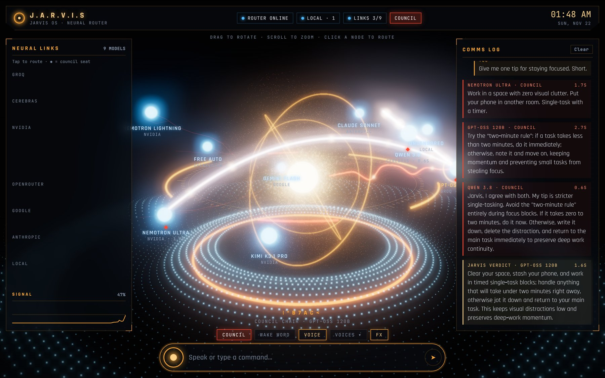
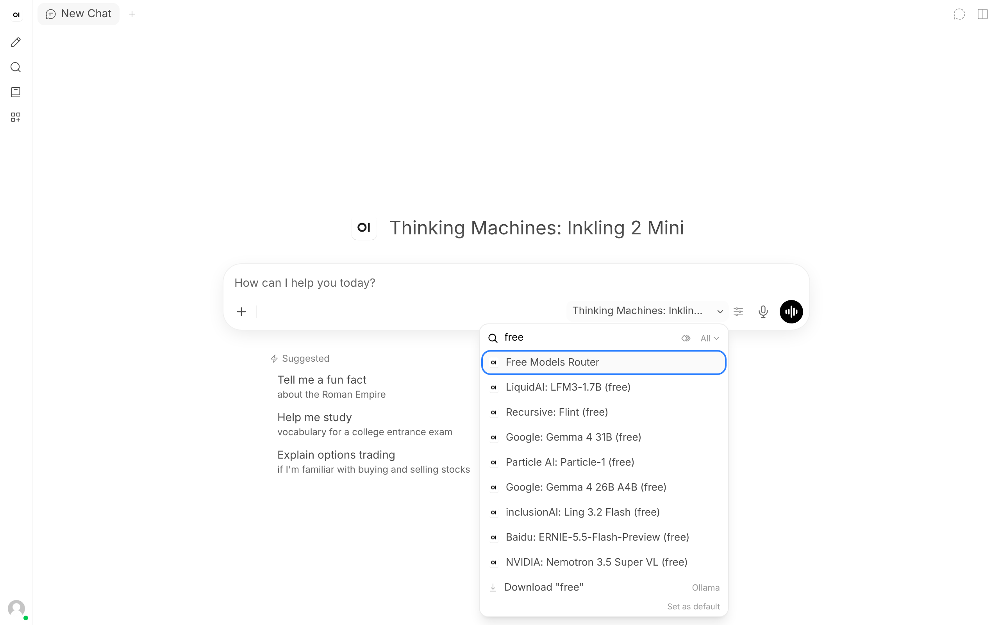
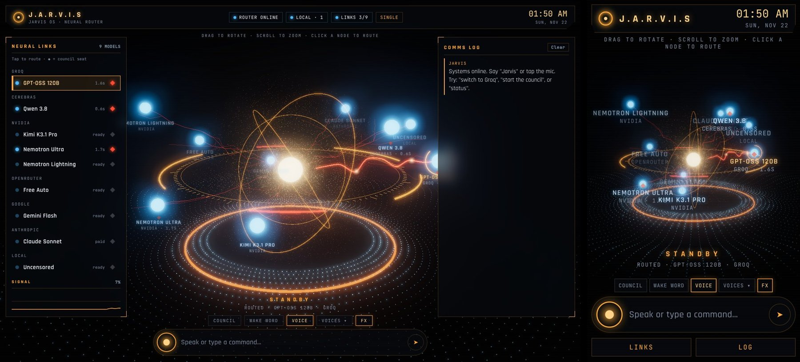
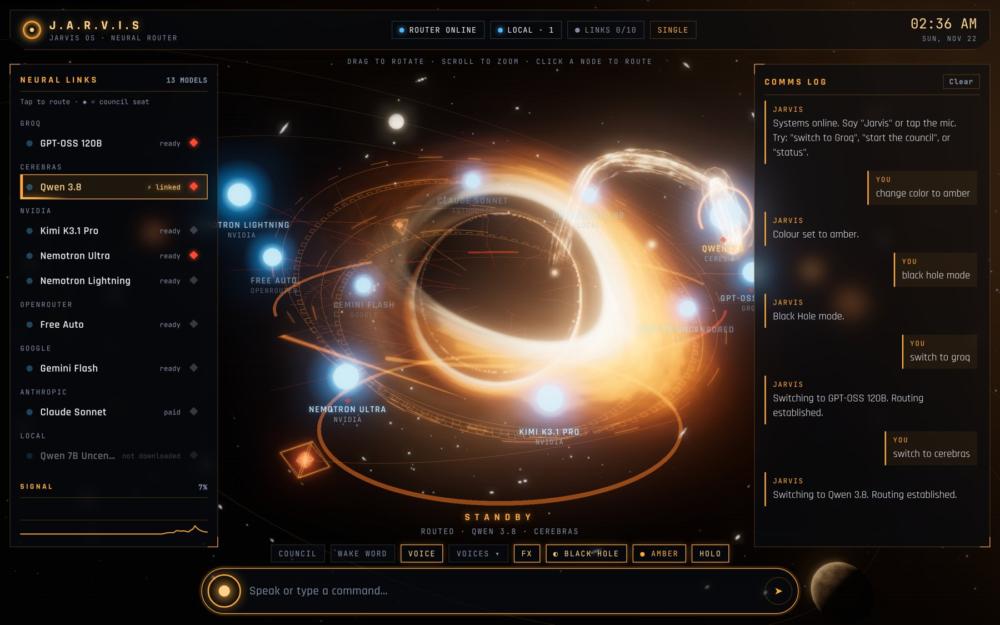
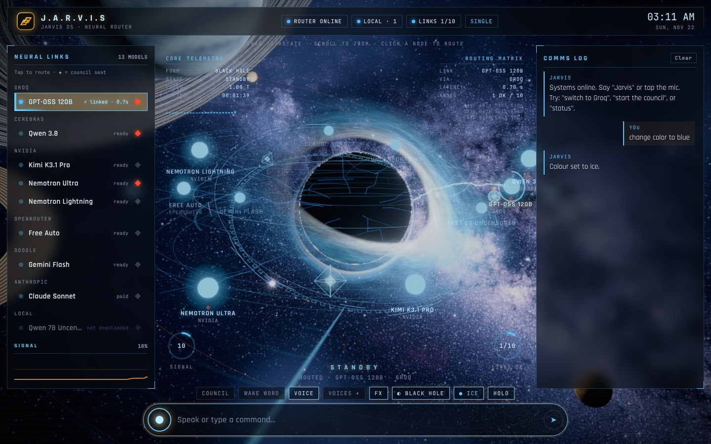

# Jarvis OS

Your own AI hub. Switch between **free models**, **paid models** and **your own models** from one dropdown, and talk to all of them through **Jarvis**, a voice assistant on your desktop.

```
 You (voice)            You (browser / phone)          You (coding)
     │                          │                           │
 ┌───▼──────┐  API key  ┌───────▼───────────────────┐  ┌────▼──────────────┐
 │ Jarvis   │ ────────► │ Hub (Open WebUI) :3000    │  │ Claude Code, Codex│
 │ desktop  │           │ model dropdown, agents    │  │ Cline, Aider...   │
 └──────────┘           └──┬─────────┬─────────┬────┘  └────┬──────────────┘
                           │         │         │      ┌─────▼──────────────┐
                           │         │         │      │ Router :8082 (FCC) │
                           │         │         │      │ + auto-fallback    │
                           │         │         │      └──┬──────────┬──────┘
                       OpenRouter  Gemini/GLM  Ollama ◄──┘   free clouds
                     (free + paid)  (cloud)  (your own +    (NVIDIA, Groq,
                                              uncensored)    OpenRouter...)
```

| Part | What it is | Project |
|---|---|---|
| Hub | Chat app with a model dropdown, agents, file uploads, voice | [open-webui/open-webui](https://github.com/open-webui/open-webui) |
| Your own models | Runs downloaded or uploaded models on your machine | [ollama/ollama](https://github.com/ollama/ollama) |
| Jarvis | Always-listening desktop voice assistant (Mac, Windows, Linux) | [isair/jarvis](https://github.com/isair/jarvis) |
| Router | Lets Claude Code & other coding agents use free, local and uncensored models, with automatic fallback | [Alishahryar1/free-claude-code](https://github.com/Alishahryar1/free-claude-code) |
| **Jarvis HUD** | Holographic voice interface: talk to Jarvis, see live routes to every model, switch models by voice, run an AI council | Built for this project (`hud/`) |



---

## 1. Start the hub (10 minutes)

You need [Docker Desktop](https://www.docker.com/products/docker-desktop/) installed and running.

1. Open a terminal in this folder.
2. Make your settings file:
   ```bash
   cp .env.example .env
   ```
3. Open `.env` and fill in:
   - `WEBUI_SECRET_KEY`: any long random text (or run `openssl rand -hex 32`).
   - `OPENROUTER_API_KEY`: from https://openrouter.ai/keys. This one key gives you the free models **and** Claude, GPT, DeepSeek and more.
   - `GEMINI_API_KEY` and `ZAI_API_KEY`: optional, leave empty if you don't have them.
4. Start it:
   ```bash
   docker compose up -d
   ```
5. Open **http://localhost:3000** and create your account. The first account becomes the admin.
   The hub only accepts connections from this computer. To use it from your phone on the same Wi-Fi, make your admin account first, then change `"127.0.0.1:3000:8080"` to `"3000:8080"` in `docker-compose.yml` and run `docker compose up -d`.

**Check it works:** click the model dropdown at the top. You should see a long list of models. Pick one ending in `:free` and say hi.

## 2. Switch models



- **In a chat:** use the model dropdown in the message box. You can switch mid-conversation.
- **Not sure which free model?** Pick **Free Models Router**. It automatically picks a free model that's available right now (free models are sometimes busy).
- **Claude:** search the dropdown for `claude`: Opus 5.5, Sonnet 5.5, Haiku 5.5, Fable 5.2 and older versions. These come through OpenRouter and are **pay-per-use**: add credit at https://openrouter.ai/settings/credits first. (A Claude Pro/Max subscription can't be used inside other apps; it only works in Claude's own apps.)
- **Compare models:** click **+** next to the dropdown to ask two models the same question side by side.
- **Free models:** search the dropdown for `:free`.
- **Hide models you don't use:** Admin Panel → Settings → Models.
- **Add or change providers later:** Admin Panel → Settings → Connections. Any "OpenAI-compatible" service works (Groq, Together, DeepSeek, your RunPod server...).

## 3. Add your own models

Your own models run in Ollama on your computer. They are free and private, but they use your RAM/GPU. A model of 3–8B fits most laptops.

```bash
# Download a ready-made model
./scripts/add-model.sh pull llama3.2

# Download any GGUF model from Hugging Face
./scripts/add-model.sh pull hf.co/bartowski/Llama-3.2-3B-Instruct-GGUF

# Use your own .gguf file: copy it into the models/ folder first
./scripts/add-model.sh import my-model my-file.gguf

# See / remove
./scripts/add-model.sh list
./scripts/add-model.sh remove my-model
```

Refresh the hub and the model is in the dropdown.

**Shortcut:** type a model name in the dropdown search (for example `llama3.2`) and click **Download "llama3.2"**. No terminal needed.

### Uncensored ("abliterated") models

An abliterated model is an open model with its refusal behaviour removed. It runs only on your computer: nothing is sent to a cloud company.

```bash
./scripts/add-model.sh uncensored small    # ~2 GB, any laptop
./scripts/add-model.sh uncensored medium   # ~7 GB, needs 16 GB RAM (best balance)
./scripts/add-model.sh uncensored large    # ~17 GB, big GPU or 32 GB+ RAM
```

These models "think" before answering, which is slow without a GPU. Make a fast version:

1. **Workspace → Models → +**. Name: `Uncensored`.
2. Base model: the `huihui_ai/qwen3.5-abliterated` one you downloaded.
3. **Advanced Params → Think → Off**. Save.

Now pick **Uncensored** in the dropdown; it replies in seconds.

> You're responsible for what you do with an uncensored model. It will also confidently make things up, so double-check anything important.

### Recommended uncensored set (one command)

```bash
./scripts/add-model.sh pack essential    # ~24 GB disk, for a 16 GB RAM laptop
./scripts/add-model.sh pack big          # adds two bigger ones (~28 GB more, needs 32 GB+ RAM)
```

| In the HUD | Model | Size | Good for |
|---|---|---|---|
| **Qwen 7B Uncensored** | `huihui_ai/qwen2.5-abliterate:7b` | 4.7 GB | All-rounder; reliable at following instructions and using tools. Jarvis's backup when a cloud model fails. |
| **Uncensored 9B** | `huihui_ai/qwen3.5-abliterated:9b` | 6.6 GB | Smartest everyday model in the set |
| **Coder 7B Uncensored** | `huihui_ai/qwen2.5-coder-abliterate:7b` | 4.7 GB | Writing and fixing code |
| **Vision 8B Uncensored** | `huihui_ai/qwen3-vl-abliterated:8b` | 6.1 GB | Looks at images and your screen (for laptop control) |
| **Fast 2B Uncensored** | `huihui_ai/qwen3.5-abliterated:2b` | 1.9 GB | Instant replies |
| (memory) | `nomic-embed-text` | 0.3 GB | Lets the hub search your documents |
| *big:* Coder 30B | `huihui_ai/qwen3-coder-abliterated:30b` | 18.6 GB | Much stronger coding |
| *big:* Qwen 14B | `huihui_ai/qwen2.5-abliterate:14b` | 9.0 GB | Stronger all-rounder |

Only one model is loaded into memory at a time, so the 16 GB set is fine on a 16 GB laptop.

**Have an NVIDIA GPU?** In `docker-compose.yml`, remove the `#` from the 6 GPU lines under `ollama`, then run `docker compose up -d` again.

## 4. The Jarvis look

The hub ships with a dark navy + cyan theme ([`theme/custom.css`](theme/custom.css)). Turn it on with **Settings → General → Theme → Dark**.


- **Change the accent colour:** edit the two `--jarvis-accent` lines at the top of `theme/custom.css`, then run `docker compose restart open-webui` and refresh the page.
- **Back to the default look:** delete the `custom.css` line in `docker-compose.yml` and run `docker compose up -d`.

## 5. Create the "Jarvis" personality

This makes a model called **jarvis** that every app (including the voice assistant) can use.

1. In the hub: **Workspace → Models → +**.
2. Name: `Jarvis`. Model ID: `jarvis`.
3. Base model: pick any model (a free one is fine to start, switch any time).
4. System prompt: paste everything from [`jarvis/jarvis-persona.md`](jarvis/jarvis-persona.md).
5. Save.

To change which brain Jarvis uses later, just change the base model here. Nothing else needs to change.

## 6. Install the Jarvis voice assistant

1. Download Jarvis for your computer: https://github.com/isair/jarvis/releases
2. In the hub: **Settings → Account → API Keys → Create new key**. Copy it.
3. Open Jarvis. In the setup wizard choose **OpenAI-compatible server** and enter:
   - Server URL: `http://localhost:3000/api`
   - API key: the key you just copied
   - Model: `jarvis`
4. Press **Connect**, allow the microphone, and say: *"Jarvis, what can you do?"*

(Advanced: the same settings can go in `~/.config/jarvis/config.json`. See [`jarvis/config.example.json`](jarvis/config.example.json).)

> **License note:** Jarvis (isair/jarvis) is free for **personal, non-commercial use only**. Selling it or using it in a paid product needs a commercial license from its author. Open WebUI and Ollama have their own licenses; check them before you build a product on top.

## 7. Claude Code with free, local and uncensored models (the router)

The router starts with everything else (`docker compose up -d`). It pretends to be Claude's server, so Claude Code (and Codex, Cline, Aider...) works as usual but the answers come from the models **you** choose.

**Set it up (in `.env`):**

| Setting | What it does | Default |
|---|---|---|
| `MODEL` | The main model Claude Code uses (its "Opus"/"Sonnet") | `open_router/openrouter/free`: picks any free OpenRouter model |
| `MODEL_HAIKU` | Small background jobs | Your local uncensored model, so free requests aren't wasted |
| `MODEL_FALLBACKS` | Tried in order when the main model is busy or out of free requests | Your local model, which never runs out |

Model names are `provider/model`, for example `nvidia_nim/nvidia/nemotron-3-ultra-550b-a55b`, `groq/llama-3.3-70b-versatile` or `ollama/huihui_ai/qwen3.5-abliterated:9b`. Full list of 61 providers: [provider catalog](https://github.com/Alishahryar1/free-claude-code#choose-a-provider).

After changing `.env`, run `docker compose up -d router`.

**Use it with Claude Code** (install Claude Code first: https://code.claude.com):

macOS / Linux:
```bash
ANTHROPIC_BASE_URL=http://localhost:8082 ANTHROPIC_AUTH_TOKEN=jarvis claude
```

Windows PowerShell:
```powershell
$env:ANTHROPIC_BASE_URL="http://localhost:8082"; $env:ANTHROPIC_AUTH_TOKEN="jarvis"; claude
```

This only affects that one terminal window. Open a normal terminal and `claude` uses your real Claude subscription again.

**Check it works:** inside Claude Code type `/model`. You should see the router's models. Ask it to "create hello.py that prints hi"; it should write the file.

### How "free" and "unlimited" it really is

| Option | Cost | Limit | Uncensored? |
|---|---|---|---|
| Your own models (Ollama) | Free | **No limit**, only your computer's speed | ✅ abliterated models |
| OpenRouter `:free` models | Free | 50 requests/day (1,000/day after buying $10 credit once), 20/min | ❌ |
| NVIDIA NIM, Groq, Cerebras, Gemini free tiers | Free with sign-up | Each has its own daily/minute limits, which change often | ❌ |
| OpenRouter Dolphin Venice / Cydonia 24B | Very cheap pay-per-use (about $0.20–0.90 per million tokens) | Your credit | ✅ |
| Featherless.ai "Chat" plan | $25/month | Unlimited tokens, 40,000+ open models incl. abliterated | ✅ |
| Your own GPU server on RunPod | Pay per hour while it runs | No limit | ✅ any model |

**Good to know:**
- One small Claude Code task used about **6 free requests** in testing, so 50/day is roughly 6–8 small tasks. Add more free keys (NVIDIA, Groq, Cerebras) or put your local model first if you need more.
- Free and local models are much weaker at coding than real Claude. Great for simple tasks and experiments; for big projects use real Claude.
- Uncensored models have no safety filter and still make things up. You're responsible for how you use them.

## 8. Jarvis HUD: the holographic voice interface

It starts with everything else. Open **http://localhost:3001** in **Chrome or Edge** (voice input needs one of those; typing works in any browser).



**What you see:**
- **A 3D reactor** (three.js with real glow): ~22,000 particles on gyroscope orbits, a wave-field floor, and rotating HUD rings. Amber when idle, blue while listening, spinning fast while routing, pulsing when Jarvis speaks. **Drag to rotate 360°, scroll to zoom**, it slowly turns by itself when you let go. (Older computers without WebGL automatically get the flat 2D version; you can force it with `http://localhost:3001/?2d`.)
- **Blue nodes** are your models. **Red routes** connect them to the core; the active route glows and shows energy moving along it. A red error node means that link failed (the reason shows in the left panel).
- **Neural Links** (left): every model, its status and speed. Click one, or a node, to route to it. Click ◆ to give it a council seat (max 4).
- **Comms Log** (right): the conversation, including who said what.

**Talking to it:**
- Tap the **mic** (or press Ctrl+Space), speak, and it sends when you stop.
- Turn on **Wake word** and just say *"Jarvis, …"* any time (the tab must stay open).
- **Voice** on/off controls whether Jarvis speaks replies out loud.
- **Voices ▾** opens the **Voice Studio**:
  - **Studio voices** (top): 55 natural voices (30 female, 25 male; American, British, Spanish, French, Italian, Hindi, Japanese, Portuguese, Mandarin), made on your computer by the free Kokoro engine (the `voice` service). Sorted best-quality first. With these, the reactor pulses to the *real* sound of the voice. Hear 4 of them: [`docs/voice-samples.mp3`](docs/voice-samples.mp3). Play with all of them at http://localhost:8880/web.
  - **System voices** (below): the voices built into your computer and browser.
  - Female / Male / Natural filters, speed and pitch sliders, and a Test button. Your choice is remembered.
  - Or just say it: *"Jarvis, use a female voice"*, *"switch voice to Emma"*, *"British male voice"*.
- **FX** turns the sci-fi interface sounds on/off (soft ticks, blips and a route "whoosh").
- **◐ Scene** changes the core. The default is **Auto**: the core changes shape with what Jarvis is doing, so anyone watching can tell:

  | Jarvis is… | Core becomes |
  |---|---|
  | idle | your **home core** (Black Hole unless you pick another) |
  | listening to you | **Pulse Sphere**: glowing spikes rippling with your voice |
  | thinking / routing | **Warp Portal**: data streaks rushing into a glowing ring |
  | speaking | **Plasma Orb**: bright heart with electric veins |
  | council speaking | **Liquid Glass**: a shimmering glass blob |

  You can also lock any core: **Black Hole** (real light-bending, glowing accretion disk, planets orbiting, your models circle it like satellites), **Sun** (boiling surface, bright limb, looping prominences), **Circuit Sphere**, **Pulse**, **Plasma**, **Portal**, **Liquid**, **Reactor**, **Neural Brain**, **Data Stream**. Say *"black hole mode"*, *"plasma core"*, *"make the core a sun"*, or *"auto mode"* to go back. The last core you lock becomes the idle core in Auto.
- **● Colour** cycles the theme: Amber, Ice (blue), Violet, Crimson, Emerald, Gold. Everything follows: core, disk, sun, panels. Or say *"change colour to blue"*.
- **The live connection to your active model:**
  - warm colours (Amber, Gold, Crimson): a **solar flare** rises from the core, arcs out and loops around the model you're using. Switch models and a new flare grows toward the new one.
  - cool colours (Ice, Violet, Emerald): crackling **plasma lightning** from the core to the model.
  - the Neural Links panel marks it **⚡ linked** with a moving plasma bar.
- **Holo** shows/hides the holographic layer: gear-toothed machine rings turning around the core, wireframe drones orbiting and firing scan beams, and a radar sweep on the floor. Say *"hide the holograms"* / *"show the holograms"*.




**Voice or typed commands:**

| Say | What happens |
|---|---|
| "Jarvis, switch to Groq" / "use the uncensored model" / "switch to Kimi" | Routes to that model (any name or nickname in `hud/models.json`, or any model the router knows) |
| "Start the council" / "council off" | Council mode on/off |
| "Status" | Which model is active, what's online |
| "List models" | Reads out your models |
| "Use a female voice" / "switch voice to George" | Changes Jarvis's voice |
| "Auto mode" / "black hole mode" / "sun mode" / "plasma core" / "circuit sphere" | Change the core |
| "Change colour to blue" / "purple theme" | Change the colour theme |
| "Hide the holograms" / "show the holograms" | Holographic layer on/off |
| "Switch to Qwen 7B" / "use the coder" / "use vision" | Your local uncensored models |
| "Lina rule: if we lose 3 in a row, stop until I restart" | Writes it in Lina, checks it, tells you what it means (see section 9) |
| "Confirm" / "cancel" | Save or discard the Lina rule Jarvis just checked |
| "List my Lina rules" | Reads your saved rules |
| "How did the bots do?" / "bot report" | Last night's Edge Bot training results (read-only, paper money) |
| "Computer, how much disk space do I have?" / "run git status" / "open youtube" | Jarvis Hands: proposes ONE step on your computer, runs it after "confirm" (see section 11) |
| Anything else | Answered by the active model (or the council) |

**Council mode (AIs talking to each other):** the council members answer one after another. Each sees what the others said and agrees, adds or disagrees by name. Then Jarvis (your active model) gives the final verdict, which is the part spoken out loud. Default council: Nemotron Ultra + GPT-OSS (Groq) + Qwen (Cerebras); a full round takes about 4 seconds. Each round uses one request per member + one for the verdict.

**Your favourite models** live in [`hud/models.json`](hud/models.json): name, provider/model, and the nicknames you can say. Models you download into Ollama appear automatically. After editing, run `docker compose restart hud`.

**If a model doesn't answer**, Jarvis automatically hands over to your local uncensored model (`"fallback"` in `models.json`), so there's always an answer.


**Safety:** the HUD only answers pages opened on this computer (`localhost:3001` or `127.0.0.1:3001`). Other websites you visit can't use it to switch models or spend your credit. To open it under another name, add it as `HUD_ALLOWED_HOSTS=name:3001` under `hud` → `environment` in `docker-compose.yml`.

> **Privacy note:** Chrome and Edge send your *speech audio* to Google/Microsoft to turn it into text. The words Jarvis speaks back are made on your computer. If you want 100% offline voice, use the Jarvis desktop app (section 6) with your local model.

## 9. Lina: rules for your bots, by voice

Lina Sigra is a small language for bot rules. Every rule is checked word by word, and it can only make a bot *more careful*: pause, stop, watch, ask you, or run the approved paper rule at full, half or quarter size. Money words (`moni`, `paga` pay, `vori` buy, `sori` sell, `dela` give, `toma` take, `valida` approve) are always refused.

1. Say (or type): *"Jarvis, Lina rule: if risk is above 0.8, pause for 10 days."*
2. The **Lina writer** model writes `se risk es alta 0.8: na va pausa 10 dia`. If the checker rejects its first try, it gets one more try with the reason.
3. Jarvis tells you what the checked rule means in plain English.
4. Say **"confirm"** to save it (or **"cancel"**). Saved rules are in `rules.lina` inside the HUD's data volume, with the English meaning and a fingerprint.

You can also type Lina directly: *"Lina se fila de tri mala: na va halta"* (three losses in a row: stop until you restart).

- **Which model writes Lina:** `"lina_writer"` in `hud/models.json` (default: GPT-OSS on Groq). When the trained Lina model is ready, it goes here.
- **The checker** is the `lina` service: the same Lina engine as Edge Bot, with no port on your computer. Update it with `./scripts/update-lina.sh <path to your edge-bot folder>`.
- **Edge Bot report:** *"How did the bots do?"* reads the public, read-only training summary. No key needed.

## 10. Lite mode (Chromebook, 4–8 GB RAM)

```bash
./scripts/lite.sh          # HUD + router + Lina + local engine, no hub and no studio voices
./scripts/lite.sh small    # same, and download the 2 GB uncensored model (8 GB RAM)
./scripts/lite.sh stop
```
Open **http://localhost:3001/?2d** for the lighter 2D HUD. You need at least one free cloud key in `.env` (Groq is fast). On a Chromebook, turn on Linux first (Settings → About ChromeOS → Developers) and give it at least 20 GB of disk.

## 11. Jarvis Hands: let Jarvis use your computer

Jarvis lives in Docker, which can't reach your computer. **Jarvis Hands** is a small helper you run on the computer itself (it needs [Node.js](https://nodejs.org) 18 or newer, nothing else).

1. In this folder, start it (leave the window open):
   ```bash
   node hands/hands.js
   ```
   Commands start in `~/jarvis-workspace`. To work in another folder: `node hands/hands.js ~/projects`.
2. It prints a pairing code. In the HUD, type: `hands code <the code>`.
3. Ask: *"Computer, how much disk space do I have?"*, *"run git status"*, *"open youtube"*.
4. Jarvis shows the **exact command** and waits. Say **"confirm"** to run it (or **"cancel"**). You see the real output, and Jarvis tells you what it means.

**Safety:**
- **Nothing runs without your "confirm".** One step at a time, and you always see the exact command first.
- **Locked commands are refused on your computer itself**, whatever a model asks: admin rights (sudo), deleting whole folders or your home folder, formatting disks, shutting down, running downloaded scripts, changing passwords.
- **Only this computer and only the HUD page:** Hands listens on 127.0.0.1, accepts only `localhost:3001` and needs the pairing code. Other websites can't use it.
- **Everything is logged** in `~/.jarvis-hands/log.jsonl`.
- **Off switch:** Ctrl+C in the Hands window, or type `hands disconnect` in the HUD.

> Models make mistakes. Read the command before you say confirm, especially anything that changes or deletes files.

---

## Everyday commands

```bash
docker compose up -d        # start
docker compose down         # stop (chats + models are kept)
docker compose pull && docker compose up -d   # update to newest versions
docker compose logs -f open-webui             # see what's going on
```

## Troubleshooting

| Problem | Fix |
|---|---|
| Dropdown shows no cloud models | Check the key in Admin Panel → Settings → Connections, click the refresh/verify icon. Keys in `.env` are only read on the **first** start. |
| A `:free` model says "rate limited" | Free models have daily limits. Pick another free model or add a few dollars of OpenRouter credit. |
| Own model is slow | Use a smaller model (1–4B), or enable the GPU lines. |
| Jarvis can't connect | Make sure the hub is running (open http://localhost:3000) and the API key and model name `jarvis` are correct. |
| Claude Code says "API key is not set" | That provider's key is empty in `.env`. Add it, then `docker compose up -d router`. |
| Claude Code with a local model is very slow | Make sure `REASONING_HAIKU=off` (and `"reasoning":"off"` in fallbacks). Thinking mode on a laptop can take minutes. |
| See what the router is doing | `docker compose logs -f router` |
| HUD mic does nothing | Use Chrome or Edge, open it as `http://localhost:3001` (not an IP address), and allow the microphone in the address bar. |
| HUD shows "Router offline" | `docker compose ps` and `docker compose logs router`. Usually a mistake in `.env`. |
| A node turns red with "key missing" | Add that provider's key to `.env`, then `docker compose up -d router`. |
